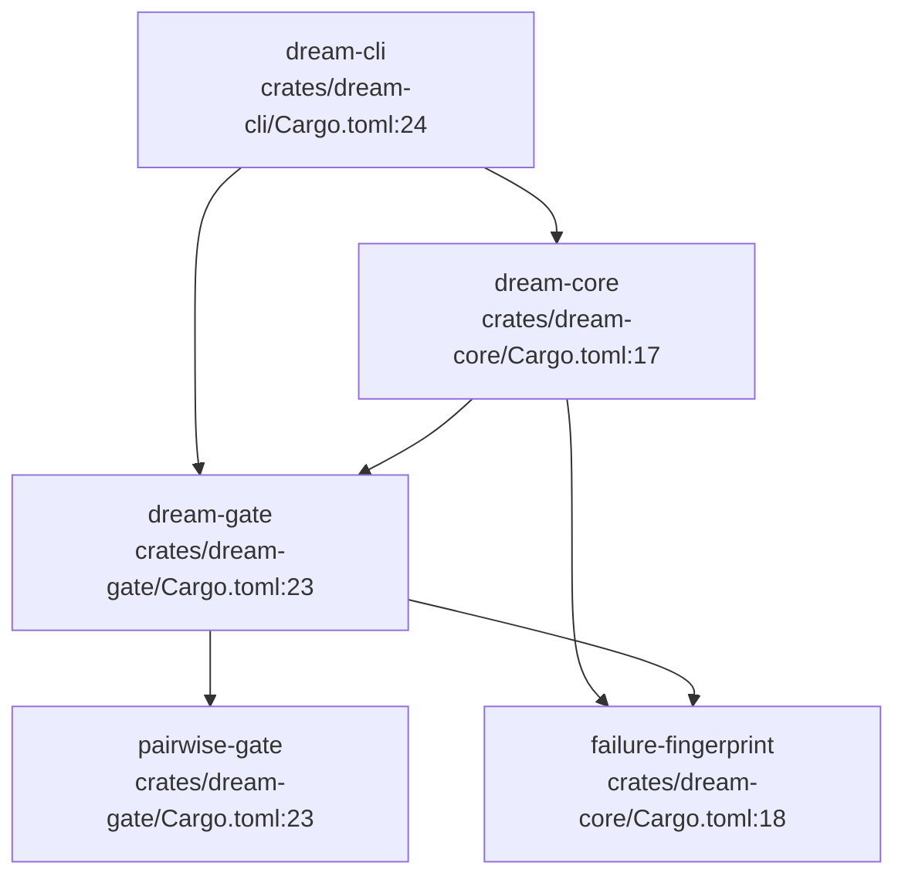
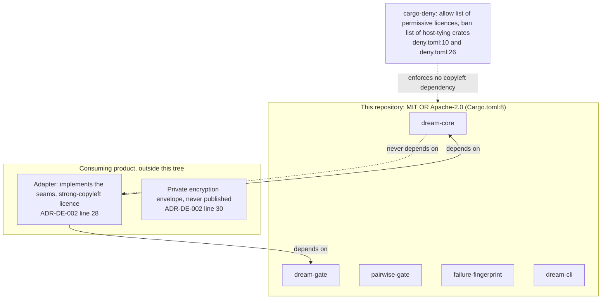

## For developers

The workspace holds five crates, all under one licence expression, and the
dependency edges only point downwards (`Cargo.toml:3`, `Cargo.toml:8`). Two
leaf crates, `pairwise-gate` and `failure-fingerprint`, know nothing of the
engine. `dream-gate` judges using both, `dream-core` does the impure work around
the judgement using `dream-gate` and `failure-fingerprint`, and `dream-cli` is a thin
shell over the last two. A consuming product brings its own adapter, which
depends on the core crates and never the other way round
(`docs/adr/ADR-DE-002-licence-and-provenance.md:28`).

## For the business

The engine is open for any repository to use under a permissive licence. The
product that consumes it keeps its own components, which carry a stronger
copyleft licence and a private encryption format, on its side of a fence. The
fence is physical: that code is not in this repository, so it cannot be pulled
in by accident, and a published crate can never force a copyleft licence onto
a downstream user.

## CRT-01.1 Crate dependencies inside the workspace

**What it shows.** Path dependencies between workspace members: no cycles, and
the two leaves have no internal dependencies of their own
(`crates/pairwise-gate/Cargo.toml:20`, `crates/failure-fingerprint/Cargo.toml:13`).
**Why it is this way.** The gate is separated from the impure loop so it can
stay a pure function that a replay can re-run
(`crates/dream-gate/src/gate.rs:8`). The selection policies and the failure
identity are separate crates because each is useful to a loop that has no
other part of this engine (`README.md:55`, `README.md:56`).
**Open:** ADR-DE-002 speaks of four core crates
(`docs/adr/ADR-DE-002-licence-and-provenance.md:23`), while the workspace has
five members, `dream-cli` being the fifth (`Cargo.toml:3`).
Resolved since the earlier stamp: the README crate table no longer calls
`dream-gate` Planned; it describes the built gate (`README.md:57`), which
`dream-core` depends on (`crates/dream-core/Cargo.toml:17`).

## CRT-01.2 The licence boundary

**What it shows.** Dependencies cross the boundary in one direction only: the
adapter depends on the core, and a permissive crate never depends on the
adapter (`docs/adr/ADR-DE-002-licence-and-provenance.md:34`).
**Why it is this way.** The licence list in `deny.toml` has no deny list; anything
not allowed is denied, which keeps copyleft licences out of the graph
(`deny.toml:7`). The ban list also names crates that would tie the engine to one
host, such as database or client crates for a particular forum stack
(`deny.toml:26`).
Resolved since the earlier stamp: the ADR now says `cargo deny check` runs in
CI (`docs/adr/ADR-DE-002-licence-and-provenance.md:42`), and CI has the `deny`
job (`.github/workflows/ci.yml:71`).
**Debt:** the workspace declares a minimum Rust version of 1.89 (`Cargo.toml:7`)
because `NightLock` uses `File::try_lock`, but every CI job installs `stable`
(`.github/workflows/ci.yml:26`); nothing builds on 1.89, so the declared floor is
untested.
**Open:** nothing in this repository verifies that the product's adapter
follows the rule in the other direction; the boundary is a convention plus a
dependency ban in the permissive tree.
