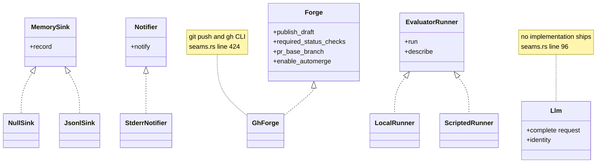
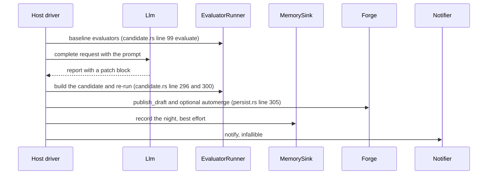

## For developers

Everything the engine must not know (which model, where memory lives, how a
test is run, where notices go, which forge hosts the pull request) is a trait.
Four traits live in `seams.rs` and the fifth, `EvaluatorRunner`, in
`runner.rs`, matching the five listed in ADR-DE-005
(`docs/adr/ADR-DE-005-seams.md:18`). The async ones return a plain boxed future
so the crate links no async runtime (`crates/dream-core/src/seams.rs:39`).

## For the business

A product plugs in its own model, memory, test machines, chat channel and code
host without forking the engine. The engine ships plain defaults that need
nothing external, so a team can try a full night on a laptop with scripted
test results before wiring any real service.

## CRT-02.1 The five seams and the implementations that ship

**What it shows.** Each trait with the implementations in this crate. `Llm` has
none: the host supplies the model (`crates/dream-core/src/seams.rs:96`).
`NullSink` and `JsonlSink` are at `seams.rs:157` and `seams.rs:202`,
`StderrNotifier` at `seams.rs:329`, `GhForge` at `seams.rs:424`, `LocalRunner` at
`runner.rs:48` and `ScriptedRunner` at `runner.rs:137`, all under
`crates/dream-core/src/`.
**Why it is this way.** The traits are dyn-compatible so a consumer holds a
`Box<dyn ...>` chosen at run time (`docs/adr/ADR-DE-005-seams.md:30`).
**Invariant:** `Notifier::notify` is infallible by signature, so a broken
channel cannot change a verdict (`crates/dream-core/src/seams.rs:320`).
**Debt:** `GhForge` has one test in this tree and it only proves the trait is
dyn-safe (`crates/dream-core/src/seams.rs:647`). The push, PR creation and
branch-protection paths have not been exercised against a live GitHub.

## CRT-02.2 Where each seam is crossed in a night

**What it shows.** The order a host drives the seams in. The engine's own
code crosses `EvaluatorRunner` in `candidate::run` and `Forge` in
`persist::publish`; the `Llm`, `MemorySink` and `Notifier` calls are the host's.
**Why it is this way.** Memory writes are best effort and callers log and
continue (`crates/dream-core/src/seams.rs:147`). A forge failure is reported
inside the `PrOutcome`, never raised, so the night still records its verdict
(`crates/dream-core/src/seams.rs:365`).
**Open:** the sequence above is the intended host order from the crate docs
(`crates/dream-core/src/lib.rs:3`). No driver in this repository enforces it,
so the order is not machine-checked here.
