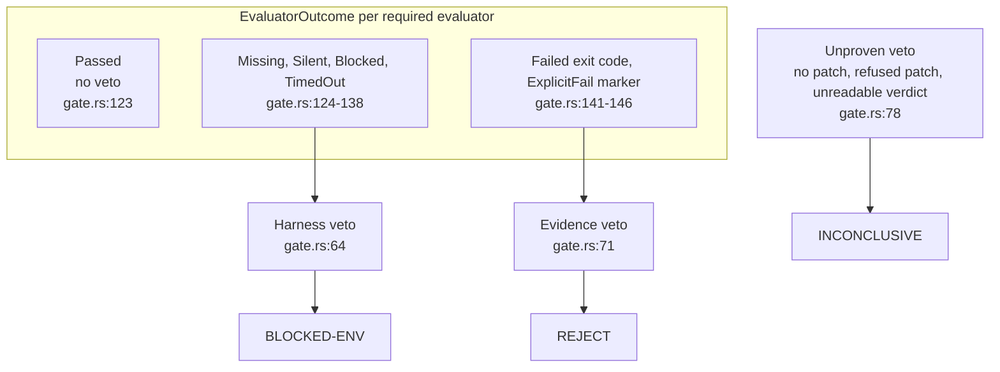
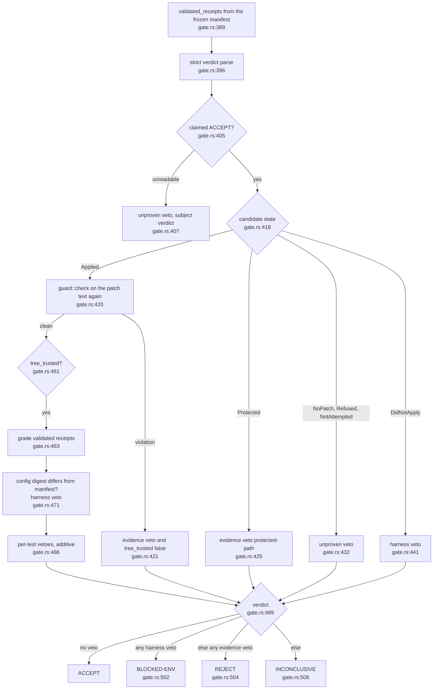
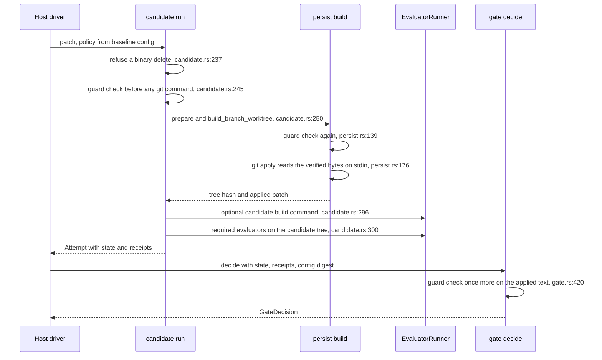
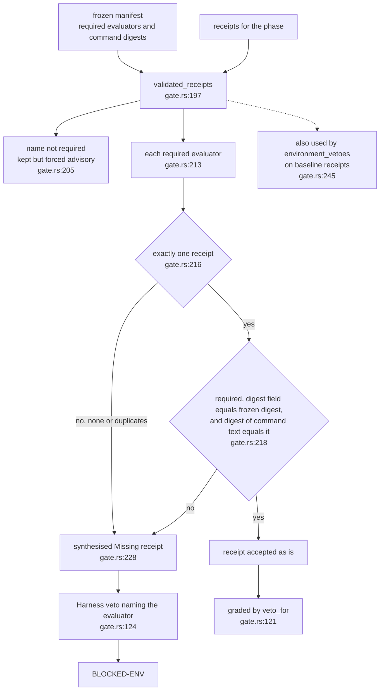
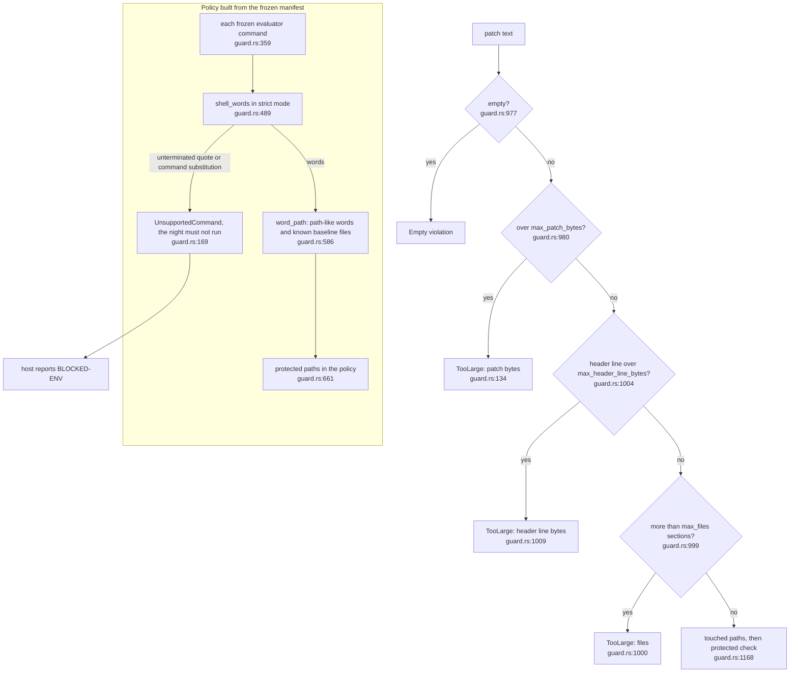

## For developers

The gate is a pure function of a frozen manifest, typed receipts and a strict
parse of the model's verdict (`crates/dream-gate/src/gate.rs:8`). This topic
covers how a veto gets its class, how classes become a verdict, and the order
of the two protected-path checks around the patch: the guard before apply and
the re-check inside `decide`. After reading it you can say which verdict a
given failure produces and why a guard refusal can never be diluted into a
harness fault.

Vetoes come in three classes (`crates/dream-gate/src/gate.rs:42`): harness
(evidence could not be gathered), evidence (gathered and against the
candidate) and unproven (nothing to test or nothing readable). The module table
maps them to `BLOCKED-ENV`, `REJECT` and `INCONCLUSIVE`
(`crates/dream-gate/src/gate.rs:17`), which matches the concepts document
(`docs/concepts.md:34`).

Two things changed after the first stamp. The gate no longer believes what a
receipt says about itself: which evaluators are required, and what command each
one ran, come from the frozen manifest and the receipts are checked against it
(`crates/dream-gate/src/gate.rs:197`). And the guard now has resource bounds, a
shell-word reader for evaluator commands, and a policy builder that refuses a
command it cannot read (`crates/dream-gate/src/guard.rs:182`,
`crates/dream-gate/src/guard.rs:489`, `crates/dream-gate/src/guard.rs:340`).

## For the business

A nightly engineer that confuses "the test machine was down" with "the change
was bad" teaches the team to distrust it. The class split keeps those apart: a
broken test runner is recorded as an environment problem and does not count
against the repository, while a change that touches the files that decide
whether it passes is rejected outright. A model that claims success but ships
no patch is not trusted either; it is recorded as inconclusive. A test result
that has been tampered with, or that was produced by a different command from
the one agreed at the start of the night, is treated as a broken test machine,
not as a pass. A patch that is absurdly large, or an evaluator command the
engine cannot read with certainty, stops the night rather than being guessed at.

## GAT-01.1 From evaluator outcome to veto class

**What it shows.** Each required evaluator outcome maps to exactly one veto
class in `veto_for` (`crates/dream-gate/src/gate.rs:121`): missing, silent,
blocked and timed-out are harness faults; a non-zero exit and an explicit
failure marker are evidence.
**Why it is this way.** A silent evaluator that exits 0 with no output proves
nothing, so it is a harness veto, not a pass
(`crates/dream-gate/src/gate.rs:128`). An evaluator with no receipt at all is
completed as `Missing` so a skipped evaluator cannot be a silent pass
(`crates/dream-gate/src/gate.rs:153`).
**Invariant:** the gate calls no model and reads no clock; the same inputs
always give the same decision (`crates/dream-gate/src/gate.rs:8`).

## GAT-01.2 The decide flow

**What it shows.** `decide` collects vetoes in steps, then picks the verdict
by precedence: harness over evidence over unproven
(`crates/dream-gate/src/gate.rs:500`). A claim that is not ACCEPT keeps the
model's own reading, or `INCONCLUSIVE` if unreadable
(`crates/dream-gate/src/gate.rs:493`).
**Why it is this way.** When the re-check refuses the patch, `tree_trusted`
goes false and step 3 is skipped, so the candidate's receipts are not graded.
Harness faults outrank evidence in general, but a refused patch skips grading,
so a guard veto can never be diluted into `BLOCKED-ENV`
(`crates/dream-gate/src/gate.rs:500`). The digest check runs only after the
guard has said the patch did not touch the config, so drift is the harness and
not the candidate (`crates/dream-gate/src/gate.rs:467`). The receipts graded
in step 3 are the validated set, so a forged receipt is already a `Missing`
harness veto by then (`crates/dream-gate/src/gate.rs:389`).
**Invariant:** acceptance needs a claimed ACCEPT and an empty veto list
(`crates/dream-gate/src/gate.rs:489`).
Resolved since the earlier stamp: the README no longer lists `dream-gate` as
planned; its crate table describes the built gate (`README.md:57`).

## GAT-01.3 Guard before apply, recheck inside the gate

**What it shows.** The patch is checked three times, at three layers, and the
first two are before any git command or build can run.
**Why it is this way.** The order is refuse, guard, worktree, build, evaluate
(`crates/dream-core/src/candidate.rs:13`). `build_branch_worktree` checks
again on the normalised text because normalisation synthesises headers and
could name a path the original did not (`crates/dream-core/src/persist.rs:127`).
The gate's own re-check is the second line for callers who skipped the first
(`crates/dream-gate/src/gate.rs:367`), and `GateContext` makes the policy
mandatory so the re-check cannot be silently absent
(`crates/dream-gate/src/gate.rs:298`). The policy is built from the baseline
config, so a patch cannot weaken the rules it is judged by
(`crates/dream-core/src/candidate.rs:141`). The worktree step feeds the
verified patch to `git apply` on standard input, so no patch file is ever
written to the temp directory and a pre-planted symlink at the old predictable
name is never followed (`crates/dream-core/src/git.rs:23`,
`crates/dream-core/src/persist.rs:168`).
**Debt:** the optional candidate build command and the evaluators execute the
candidate's own scripts on the evaluation host through the runner
(`crates/dream-core/src/candidate.rs:296`). The guard protects the evaluator
files named in policy, but a candidate-added build script still runs with the
runner's privileges; isolation is the host's job.
**Open:** a patch the guard cannot parse with certainty (malformed, symlink,
binary, escape, too large) ends as `INCONCLUSIVE` or `REJECT` depending on
which layer sees it. Before apply, `candidate::run` maps `Protected` to the
evidence state but every other violation to `Refused`, which is unproven
(`crates/dream-core/src/candidate.rs:207`, `crates/dream-gate/src/gate.rs:437`).
The gate's own re-check of an `Applied` patch maps every violation other than
`Protected` to an evidence veto, `patch-guard` (`crates/dream-gate/src/gate.rs:353`).
Both are current behaviour, and the guard's own docs tell callers to treat the
non-protected violations as `REJECT`-class for consistent verdicts
(`crates/dream-gate/src/guard.rs:1160`). Through `candidate::run` a refused patch therefore ends `INCONCLUSIVE`; the
`REJECT` mapping is reached only when an `Applied` patch fails the gate's
re-check, that is a caller that skipped the pre-apply check or a replay under a
changed policy.
**Debt:** the candidate worktree path is predictable, `dream-wt-<8 hex of the
repository path digest>-<branch>` under the shared temp directory, and any
existing directory at that path is removed before use
(`crates/dream-core/src/persist.rs:142`). On a multi-user host another local
user can pre-create or race that path; the patch file that used to sit beside
it is gone, but the worktree directory is not yet unpredictable.

## GAT-01.4 Receipts are checked against the frozen manifest

**What it shows.** `decide` and `environment_vetoes` both build their receipt
set from the manifest, not from the receipts. A receipt that downgrades itself
to advisory, names a different command, carries a digest field that lies about
its own command text, or is duplicated is replaced by a `Missing` receipt,
which `veto_for` turns into a harness veto.
**Why it is this way.** Earlier the required set came from the receipts, so a
forged receipt could take itself out of the veto set. Both the stored digest
field and a digest recomputed from the command text are compared with the
frozen one, because either alone can be forged
(`crates/dream-gate/src/gate.rs:217`). A receipt for a name the manifest does
not require is kept but forced advisory, so it cannot promote itself into the
veto set either (`crates/dream-gate/src/gate.rs:208`). The forged case is a
harness fault and so `BLOCKED-ENV`, not `REJECT`, which keeps a tampered
environment from being counted as evidence against the repository.
**Invariant:** the set of required evaluators and each command's identity is
decided by the manifest alone (`crates/dream-gate/src/gate.rs:197`).
**Debt:** `complete_receipts` remains for callers holding only identities and
trusts the receipt's own fields (`crates/dream-gate/src/gate.rs:157`); `decide`
does not use it.

## GAT-01.5 Guard resource bounds and evaluator-command paths

**What it shows.** Two things the guard now does before it trusts a patch or a
policy. The patch is refused as `TooLarge` before it is split, on total size,
header line length and file count, with defaults of 4 MiB, 2000 files and
8192-byte header lines (`crates/dream-gate/src/guard.rs:192`). And the policy
for a night is built from the frozen evaluator commands read as shell words:
the files they name become protected, and a command that cannot be read with
certainty is an error rather than an approximation.
**Why it is this way.** The size check runs before the patch is split into lines, and the
unquoted `diff --git` line is split in linear time without allocating
(`crates/dream-gate/src/guard.rs:888`). Any bound
exceeded fails closed (`crates/dream-gate/src/guard.rs:963`). The tokeniser
honours POSIX quoting: unquoted `; | & < > ( ) { } ,` end a word, single quotes
are literal, double quotes honour backslash escapes (`crates/dream-gate/src/guard.rs:489`).
In strict mode an unterminated quote is an error, and so is a command
substitution, `$(` or a backtick, anywhere outside single quotes, including
inside double quotes (`crates/dream-gate/src/guard.rs:536`,
`crates/dream-gate/src/guard.rs:557`). The lenient form,
`evaluator_command_paths`, never fails and over-approximates, and is kept for
callers that are not freezing a night (`crates/dream-gate/src/guard.rs:703`).
`ProtectedPolicy::for_manifest` uses the fallible form on every frozen command
and also refuses a config whose bytes do not hash to the frozen digest
(`crates/dream-gate/src/guard.rs:340`). Files that a command names only
indirectly are the host's job: `PolicyExtras::resolving` resolves absolute
paths under the repository root and bare words that name files in the baseline
tree, errors the same way, and records the result so a replay protects exactly
what the live run did (`crates/dream-core/src/replay.rs:143`,
`crates/dream-core/src/replay.rs:173`).
**Invariant:** a protected-path policy is a pure function of the frozen
manifest, the config bytes and the recorded extras, so the live guard, the gate
and a later replay agree (`crates/dream-core/src/replay.rs:173`).
**Tension:** command substitution is refused wherever it is not in single
quotes, so a legitimate evaluator such as `cargo test $(nproc)` stops the night
as `UnsupportedCommand` (`crates/dream-gate/src/guard.rs:557`); the rule is
safe and blunt, and the evaluator has to be rewritten.
**Debt:** the reader cannot see files an evaluator reads indirectly (a
`Makefile` behind `make test`, a `conftest.py` behind `pytest`); those must be
named in the config's `protected` globs, or be baseline-tree files resolved by
the host (`crates/dream-gate/src/guard.rs:703`).
