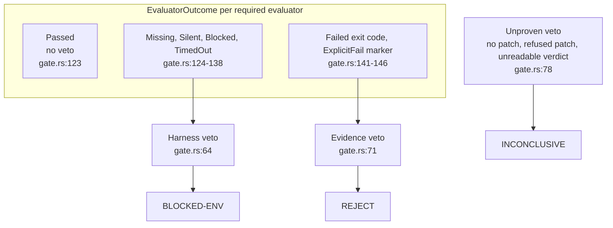
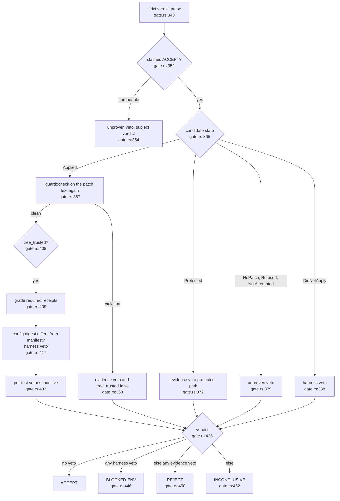
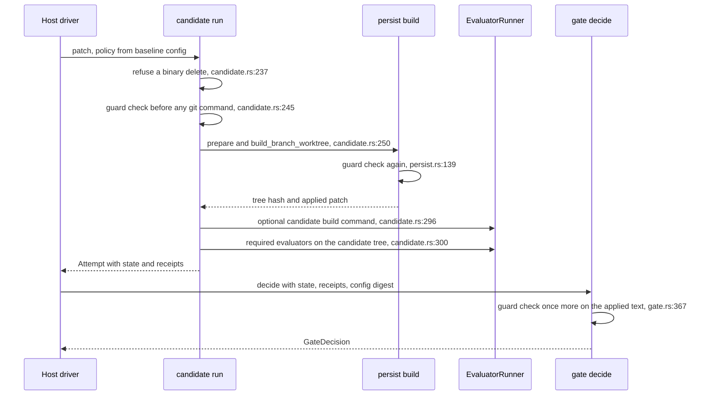

## For developers

The gate is a pure function of a frozen manifest, typed receipts and a strict
parse of the model's verdict (`crates/dream-gate/src/gate.rs:8`). This topic
covers how a veto gets its class, how classes become a verdict, and the order
of the two protected-path checks around the patch: the guard before apply and
the re-check inside `decide`. After reading it you can say which verdict a
given failure produces and why a guard refusal can never be diluted into a
harness fault.

Vetoes come in three classes (`crates/dream-gate/src/gate.rs:42`): harness
(evidence could not be gathered), evidence (gathered and against the
candidate) and unproven (nothing to test or nothing readable). The module table
maps them to `BLOCKED-ENV`, `REJECT` and `INCONCLUSIVE`
(`crates/dream-gate/src/gate.rs:17`), which matches the concepts document
(`docs/concepts.md:34`).

## For the business

A nightly engineer that confuses "the test machine was down" with "the change
was bad" teaches the team to distrust it. The class split keeps those apart: a
broken test runner is recorded as an environment problem and does not count
against the repository, while a change that touches the files that decide
whether it passes is rejected outright. A model that claims success but ships
no patch is not trusted either; it is recorded as inconclusive.

## GAT-01.1 From evaluator outcome to veto class

**What it shows.** Each required evaluator outcome maps to exactly one veto
class in `veto_for` (`crates/dream-gate/src/gate.rs:121`): missing, silent,
blocked and timed-out are harness faults; a non-zero exit and an explicit
failure marker are evidence.
**Why it is this way.** A silent evaluator that exits 0 with no output proves
nothing, so it is a harness veto, not a pass
(`crates/dream-gate/src/gate.rs:128`). An evaluator with no receipt at all is
completed as `Missing` so a skipped evaluator cannot be a silent pass
(`crates/dream-gate/src/gate.rs:153`).
**Invariant:** the gate calls no model and reads no clock; the same inputs
always give the same decision (`crates/dream-gate/src/gate.rs:8`).

## GAT-01.2 The decide flow

**What it shows.** `decide` collects vetoes in steps, then picks the verdict
by precedence: harness over evidence over unproven
(`crates/dream-gate/src/gate.rs:446`). A claim that is not ACCEPT keeps the
model's own reading, or `INCONCLUSIVE` if unreadable
(`crates/dream-gate/src/gate.rs:439`).
**Why it is this way.** When the re-check refuses the patch, `tree_trusted`
goes false and step 3 is skipped, so the candidate's receipts are not graded.
Harness faults outrank evidence in general, but a refused patch skips grading,
so a guard veto can never be diluted into `BLOCKED-ENV`
(`crates/dream-gate/src/gate.rs:447`). The digest check runs only after the
guard has said the patch did not touch the config, so drift is the harness and
not the candidate (`crates/dream-gate/src/gate.rs:414`).
**Invariant:** acceptance needs a claimed ACCEPT and an empty veto list
(`crates/dream-gate/src/gate.rs:436`).
**Drift (docs vs code):** the README table still lists `dream-gate` as
Planned (`README.md:54`) though the crate, `decide` and the guard are built.

## GAT-01.3 Guard before apply, recheck inside the gate

**What it shows.** The patch is checked three times, at three layers, and the
first two are before any git command or build can run.
**Why it is this way.** The order is refuse, guard, worktree, build, evaluate
(`crates/dream-core/src/candidate.rs:13`). `build_branch_worktree` checks
again on the normalised text because normalisation synthesises headers and
could name a path the original did not (`crates/dream-core/src/persist.rs:127`).
The gate's own re-check is the second line for callers who skipped the first
(`crates/dream-gate/src/gate.rs:316`), and `GateContext` makes the policy
mandatory so the re-check cannot be silently absent
(`crates/dream-gate/src/gate.rs:239`). The policy is built from the baseline
config, so a patch cannot weaken the rules it is judged by
(`crates/dream-core/src/candidate.rs:141`).
**Debt:** the optional candidate build command and the evaluators execute the
candidate's own scripts on the evaluation host through the runner
(`crates/dream-core/src/candidate.rs:296`). The guard protects the evaluator
files named in policy, but a candidate-added build script still runs with the
runner's privileges; isolation is the host's job.
**Open:** a patch the guard cannot parse with certainty is `Refused`, mapped to
unproven (`INCONCLUSIVE`) in the candidate module
(`crates/dream-core/src/candidate.rs:207`), while the gate's own re-check maps
the same failure to an evidence veto, `patch-guard` (`crates/dream-gate/src/gate.rs:65`).
The same parse failure can end as `INCONCLUSIVE` or `REJECT` by layer.
