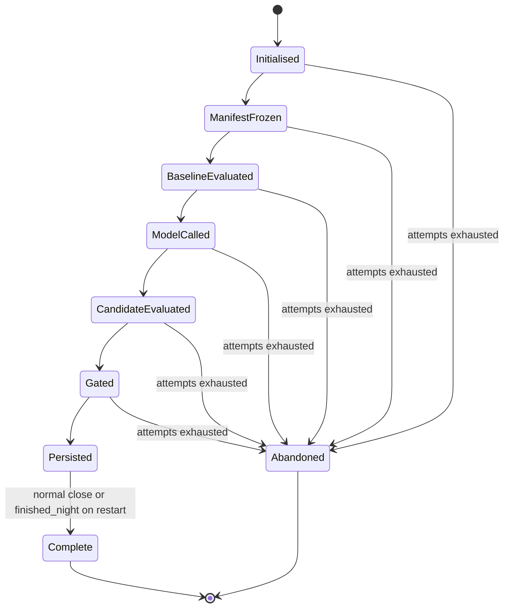
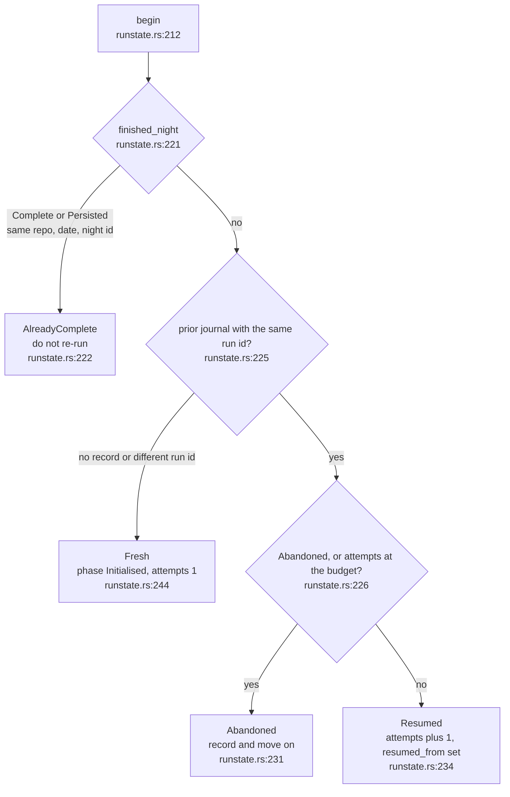
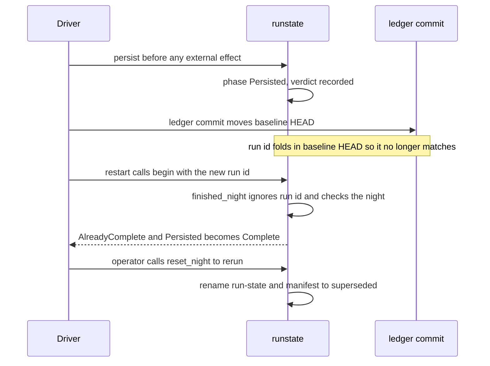

## For developers

One night is one experiment against one repository. This topic is the
restart-safety half of that: the `Phase` journal that `dream-core` writes beside
the frozen manifest, and the rules that decide, on every start, whether a night
is fresh, resumed, already finished or abandoned. After reading it you can
predict what a crash at any point costs.

The phases are an ordered enum so `>=` comparisons are meaningful
(`crates/dream-core/src/runstate.rs:33`). The ladder the concepts document
describes (`docs/concepts.md:20`) is `ManifestFrozen`, `BaselineEvaluated`,
`ModelCalled`, `CandidateEvaluated`, `Gated`; the code adds `Initialised`
before it and `Persisted`, `Complete` and `Abandoned` after it
(`crates/dream-core/src/runstate.rs:36`). The run id is a pure function of the
manifest fields (`crates/dream-gate/src/manifest.rs:202`), so a restart finds
its own journal. But the run id folds in the baseline HEAD, which the engine's
own ledger commit moves, so the terminal rule is night-level, not run-level
(`crates/dream-core/src/runstate.rs:158`, ADR-DE-007).

This crate ships the journal, not the driver that sequences the phases: the
crate docs list `runstate` among the pieces a host drives
(`crates/dream-core/src/lib.rs:21`).

## For the business

A nightly job that can be killed by a reboot has two bad outcomes: it silently
runs the same night twice, or it silently never finishes. The journal rules out
both. A finished night is never repeated by accident, an interrupted one gets
exactly one more try, and a night that keeps dying is parked loudly rather than
retried forever. The one deliberate way to rerun a finished night is an
operator action that archives, and never deletes, the old record.

## NIT-01.1 Phases of a night

**What it shows.** The nine `Phase` values in progress order. `Persisted` is
entered before the draft pull request and ledger row are written, and
`Abandoned` is reachable from any non-terminal phase when `begin` finds the
attempt budget spent.
**Why it is this way.** `advance` only moves forward, so a resumed run
re-walking earlier steps cannot rewrite history
(`crates/dream-core/src/runstate.rs:268`). `Persisted` is deliberately entered
first, so a crash can lose a publish but never repeat one
(`crates/dream-core/src/runstate.rs:49`).
**Invariant:** `advance` never lowers the phase (`crates/dream-core/src/runstate.rs:269`).
**Tension:** the at-most-once ordering is a documented caller contract on
`persist` (`crates/dream-core/src/runstate.rs:276`); no code in this repository
sequences it, so nothing here enforces it, and a crash between `Persisted` and
the forge push loses that night's publish with no retry.

## NIT-01.2 What begin decides on every start

**What it shows.** The four-way answer `begin` returns. Only `Fresh` and
`Resumed` say proceed (`crates/dream-core/src/runstate.rs:134`).
**Why it is this way.** The updated record is saved before `begin` returns, so
a crash straight after still counts the attempt and an interrupted run can
never pass as fresh (`crates/dream-core/src/runstate.rs:209`). The default
budget is two: one clean try plus one recovery (`crates/dream-core/src/runstate.rs:31`).
A different run id means the baseline or config moved, which is a new
experiment, and the manifest freeze has already archived the old document
(`crates/dream-core/src/runstate.rs:241`).
**Invariant:** a night already `Persisted` or `Complete` is `AlreadyComplete`
whatever the run id says (`crates/dream-core/src/runstate.rs:206`).

## NIT-01.3 The night-level terminal rule

**What it shows.** Why the rule is keyed on the night, not the run id: the
engine's own commit changes the id a restart computes.
**Why it is this way.** ADR-DE-007 records that a night is identified by its
directory (`crates/dream-core/src/runstate.rs:7`). `reset_night` renames the
two files and deletes nothing (`crates/dream-core/src/runstate.rs:188`).
Finalising `Persisted` to `Complete` is best effort and the answer does not
depend on the write landing (`crates/dream-core/src/runstate.rs:180`).
**Open:** the manifest archive on a moved baseline is named by run id
(`crates/dream-gate/src/manifest.rs:249`), the reset archive by timestamp
(`crates/dream-core/src/runstate.rs:194`); two naming schemes for superseded
documents.
