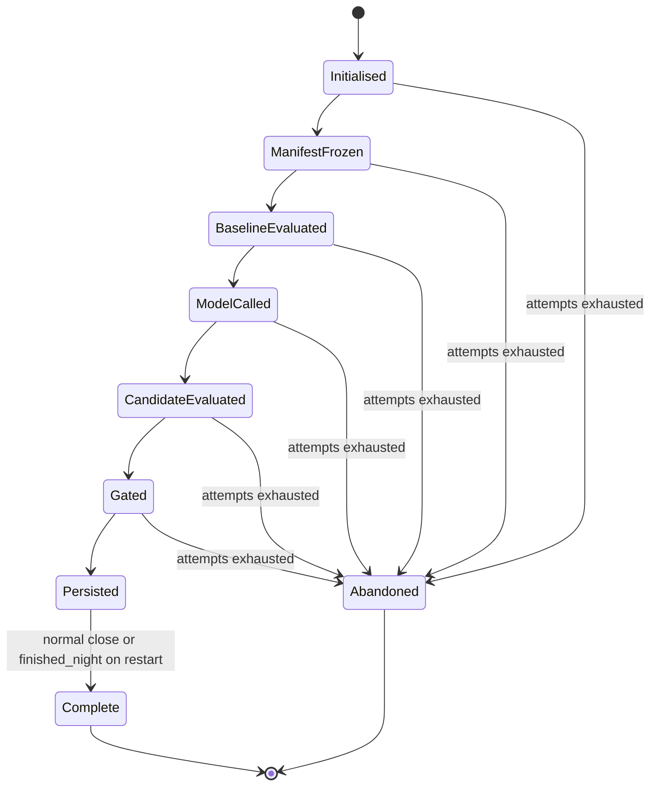
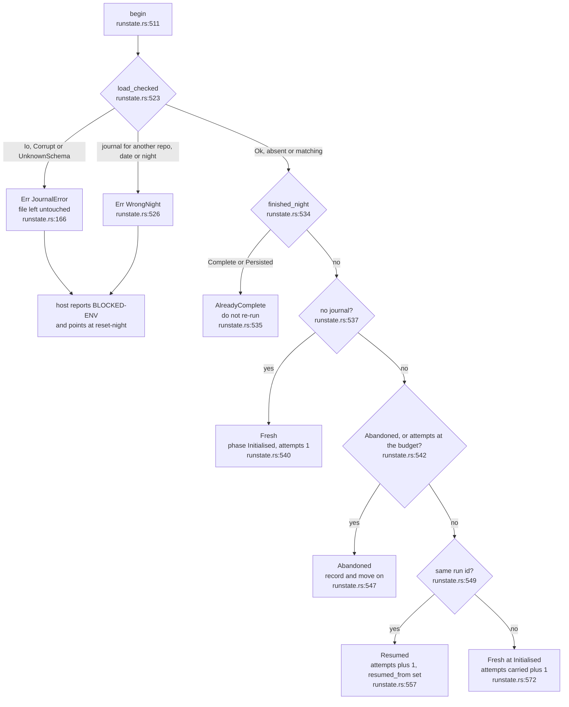
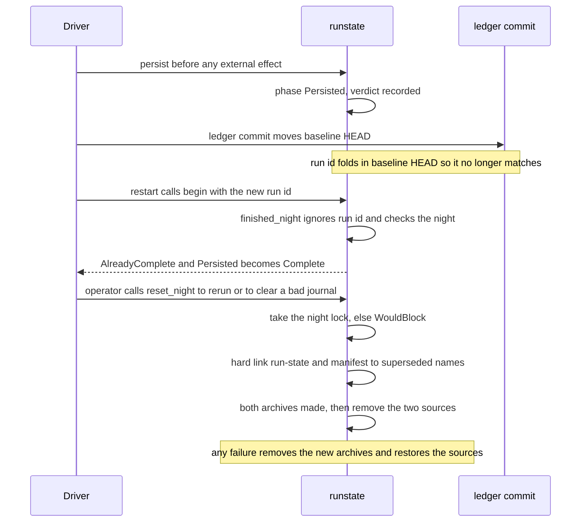
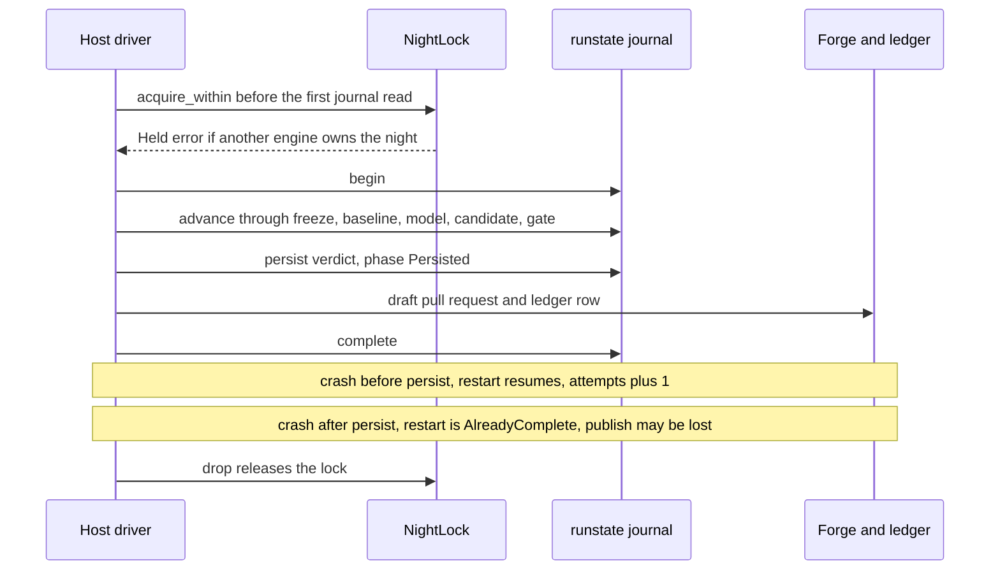

## For developers

One night is one experiment against one repository. This topic is the
restart-safety half of that: the `Phase` journal that `dream-core` writes beside
the frozen manifest, the lock that keeps two engines off one night, and the
rules that decide, on every start, whether a night is fresh, resumed, already
finished, abandoned or untrustworthy. After reading it you can predict what a
crash at any point costs.

The phases are an ordered enum so `>=` comparisons are meaningful
(`crates/dream-core/src/runstate.rs:56`). The ladder the concepts document
describes (`docs/concepts.md:20`) is `ManifestFrozen`, `BaselineEvaluated`,
`ModelCalled`, `CandidateEvaluated`, `Gated`; the code adds `Initialised`
before it and `Persisted`, `Complete` and `Abandoned` after it
(`crates/dream-core/src/runstate.rs:58`). The run id is a pure function of the
manifest fields (`crates/dream-gate/src/manifest.rs:202`), so a restart finds
its own journal. But the run id folds in the baseline HEAD, which the engine's
own ledger commit moves, so the terminal rule is night-level, not run-level
(`crates/dream-core/src/runstate.rs:401`, ADR-DE-007). The attempt budget is
night-level for the same reason: a changed run id carries the count forward
(`crates/dream-core/src/runstate.rs:567`).

Since the audit hardening, three things changed shape. A journal is read with
`load_checked`, which separates absent (`Ok(None)`) from unusable, and every
unusable journal is a typed `JournalError` rather than a silent fresh start
(`crates/dream-core/src/runstate.rs:337`). A `NightLock` is held across the
whole night (`crates/dream-core/src/runstate.rs:248`). And `reset_night` is a
two-step archive that cannot collide with an earlier archive
(`crates/dream-core/src/runstate.rs:441`).

This crate ships the journal, not the driver that sequences the phases: the
crate docs list `runstate` among the pieces a host drives
(`crates/dream-core/src/lib.rs:21`).

## For the business

A nightly job that can be killed by a reboot has two bad outcomes: it silently
runs the same night twice, or it silently never finishes. The journal rules out
both. A finished night is never repeated by accident, an interrupted one gets
exactly one more try, and a night that keeps dying is parked loudly rather than
retried forever, even if every retry looks like a different experiment. Two
copies of the engine cannot work the same night at once. If the record itself
is damaged, the night stops and is reported as an environment problem, naming
the operator command that clears it; the damaged file is kept as evidence.
The one deliberate way to rerun a finished night is that operator action, and
it archives, never deletes, the old record. The price of never repeating a
publish is that a crash at the wrong moment can lose one (see the register).

## NIT-01.1 Phases of a night

**What it shows.** The nine `Phase` values in progress order. `Persisted` is
entered before the draft pull request and ledger row are written, and
`Abandoned` is reachable from any non-terminal phase when `begin` finds the
night's attempt budget spent.
**Why it is this way.** `advance` only moves forward, so a resumed run
re-walking earlier steps cannot rewrite history
(`crates/dream-core/src/runstate.rs:604`). `Persisted` is deliberately entered
first, so a crash can lose a publish but never repeat one
(`crates/dream-core/src/runstate.rs:72`).
**Invariant:** `advance` never lowers the phase (`crates/dream-core/src/runstate.rs:605`).
**Tension:** the at-most-once ordering is a documented caller contract on
`persist` (`crates/dream-core/src/runstate.rs:615`); no code in this repository
sequences it, so nothing here enforces it. Nothing records the forge push or
the ledger commit either, so a crash after `Persisted` loses that night's
publish and the restart finalises the night to `Complete` without
reconciling against the forge; recovery is `reset_night`
(`crates/dream-core/src/runstate.rs:401`).

## NIT-01.2 What begin decides on every start

**What it shows.** What `begin` returns or refuses. `Fresh` and `Resumed` say
proceed (`crates/dream-core/src/runstate.rs:154`); `AlreadyComplete` and
`Abandoned` say stop; a `JournalError` says the night cannot be judged at all.
The enum has no corrupt variant: damage is the `Err` side of the `Result`.
**Why it is this way.** A damaged journal must never read as a fresh night,
because that reopens a finished one and resets its attempt budget
(`crates/dream-core/src/runstate.rs:333`). Absence is the only thing that
reads as fresh (`crates/dream-core/src/runstate.rs:341`). The budget check
comes before the run-id comparison, so an exhausted night stays abandoned
whatever the run id is, and a different run id (the baseline or config
moved) starts a fresh experiment but still counts the attempt, so a run id
that changes on every failure cannot loop forever
(`crates/dream-core/src/runstate.rs:567`). The updated record is saved
before `begin` returns, so a crash straight after still counts the attempt
(`crates/dream-core/src/runstate.rs:556`). The default budget is two: one
clean try plus one recovery (`crates/dream-core/src/runstate.rs:51`). For a
moved baseline the manifest freeze has already archived the old document
(`crates/dream-core/src/runstate.rs:559`).
**Invariant:** a night already `Persisted` or `Complete` is `AlreadyComplete`
whatever the run id says (`crates/dream-core/src/runstate.rs:534`).
**Invariant:** only a missing file is absent; an unreadable, garbled or
unknown-schema journal is an error, never `Ok(None)`
(`crates/dream-core/src/runstate.rs:341`).

## NIT-01.3 The night-level terminal rule

**What it shows.** Why the rule is keyed on the night, not the run id: the
engine's own commit changes the id a restart computes. And how the operator
reopens a night: `reset_night` archives both files or neither.
**Why it is this way.** ADR-DE-007 records that a night is identified by its
directory (`crates/dream-core/src/runstate.rs:7`). Finalising `Persisted` to
`Complete` is best effort and the answer does not depend on the write landing
(`crates/dream-core/src/runstate.rs:419`). The archive stamp is UTC
nanoseconds plus the process id and a counter (`crates/dream-core/src/runstate.rs:452`),
and each archive is made by `hard_link`, which fails rather than replacing an
existing name (`crates/dream-core/src/runstate.rs:466`). That removes the old
failure where two resets in one clock tick could overwrite an archive. If the
second archive cannot be made the first is deleted, and if a source cannot be
removed the already removed ones are linked back
(`crates/dream-core/src/runstate.rs:468`). `reset_night` takes the night lock
and waits at most 500 ms, so it cannot run under a live engine
(`crates/dream-core/src/runstate.rs:442`).
**Open:** the manifest archive on a moved baseline is named by run id
(`crates/dream-gate/src/manifest.rs:249`), the reset archive by timestamp
(`crates/dream-core/src/runstate.rs:452`); two naming schemes for superseded
documents.

## NIT-01.4 The night lock and what a crash costs

**What it shows.** The lock spans check, freeze, execute and persist, so two
engines cannot both read an absent journal and both publish, and where each
crash window lands. Dropping the lock, or the process dying however abruptly,
releases it.
**Why it is this way.** The lock is `flock`-style on `<night_dir>/.lock` and
is per open file description, so a second acquire in the same process
conflicts like one from another process (`crates/dream-core/src/runstate.rs:274`).
`acquire_within` retries for a short while because a descriptor briefly
duplicated into a forked child can make a just released lock look held
(`crates/dream-core/src/runstate.rs:295`). A crash before `persist` costs one
attempt out of two; a crash after it costs the publish
(`crates/dream-core/src/runstate.rs:615`).
**Open:** holding the lock is, like the persist ordering, a contract on the
host. `begin` does not take it and nothing else in this repository calls
`NightLock::acquire`, so an engine that skips it is not stopped here
(`crates/dream-core/src/runstate.rs:261`).
