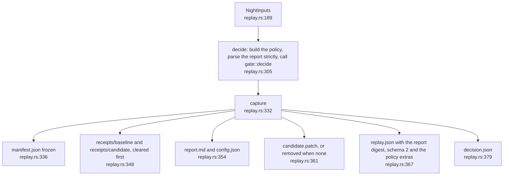
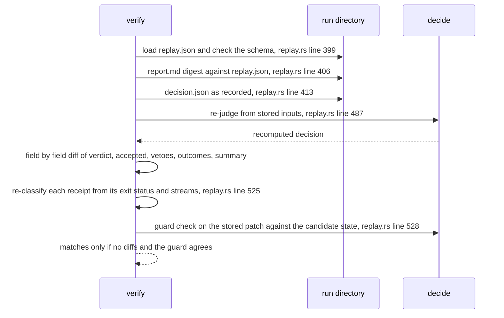

## For developers

Because the gate is pure, a night can be recorded as its inputs and judged
again later. `capture` writes the inputs and the decision under the run
directory, and `verify` re-judges from the stored inputs and diffs the result
against the recorded decision, which it never trusts
(`crates/dream-core/src/replay.rs:6`). `capture` and `verify` share one
function, `decide`, so they cannot disagree about method
(`crates/dream-core/src/replay.rs:305`). The command-line entry is
`replay_verify` (`crates/dream-cli/src/lib.rs:301`).

## For the business

Any verdict the nightly engine gave can be re-derived from the saved evidence
and compared with what was recorded. That catches accidents and drift, such as
a changed rule, a mangled file or a half-written record. It is not proof
against someone deliberately rewriting the record: the module says so itself,
and an auditor who needs that has to sign the run folder some other way.

## NIT-02.1 What is captured

**What it shows.** The seven files `capture` leaves in a run directory.
Nothing is written if judging fails (`crates/dream-core/src/replay.rs:333`).
**Why it is this way.** A restarted night may have fewer receipts than the
attempt before, and loading reads every file in a phase directory, so each
phase directory is cleared first to avoid judging a stale receipt
(`crates/dream-core/src/replay.rs:340`). Schema 1 records are refused because
they cannot say which protected-path policy the night used and guessing would
silently weaken it (`crates/dream-core/src/replay.rs:77`).
**Invariant:** the policy for a night is built by one function, so the live
guard, the gate and a later replay cannot disagree
(`crates/dream-core/src/replay.rs:173`). That function now also applies
`PolicyExtras::protected_paths`, the evaluator-named files the host resolved
against the repository and recorded in `replay.json`, so a replay protects
exactly what the live night did; a record from before that field existed
reads it as empty (`crates/dream-core/src/replay.rs:111`).

## NIT-02.2 What verify re-checks

**What it shows.** Three independent checks: the recomputed decision against
the recorded one, each receipt's typed outcome against its own raw
exit status and streams, and the stored patch against the recorded candidate
state (`crates/dream-core/src/replay.rs:485`).
**Why it is this way.** The gate reads the typed outcome, so a receipt whose
exit status was edited after the fact would otherwise pass unnoticed
(`crates/dream-core/src/replay.rs:467`).
**Tension:** replay is not tamper evidence. Only the report and the config
are digest-bound, so editing a receipt's exit status, outcome and streams
together with `decision.json` defeats `verify`
(`crates/dream-core/src/replay.rs:10`). A witness over the run directory is
the stated remedy and lives elsewhere (`crates/dream-core/src/replay.rs:18`).
**Debt:** no historical corpus exists; only nights captured after this module
is wired in can be replayed (`crates/dream-core/src/replay.rs:20`).
**Open:** nothing in this repository calls `capture` during a night. The host
driver has to, so whether any real night is replayable depends on the host.
