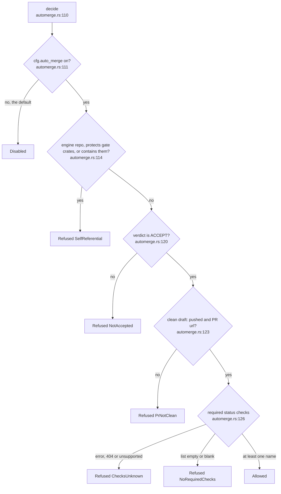
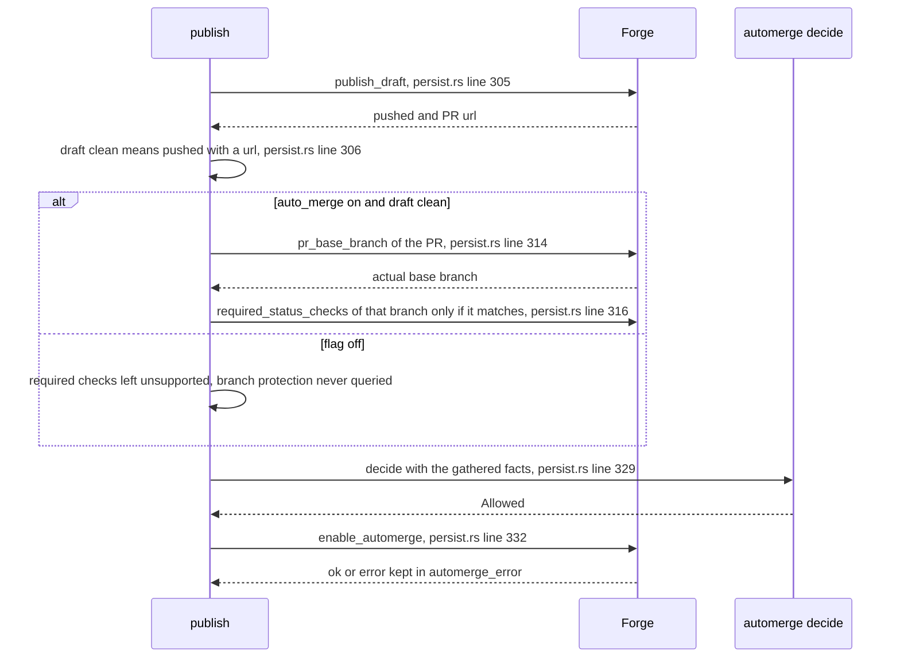

## For developers

An ACCEPT says the repository's evaluators did not object, not that the
change is wanted, so the default is a draft pull request a human merges
(`crates/dream-core/src/automerge.rs:3`). `automerge::decide` is a pure
function that turns facts the caller gathered into `Disabled`, `Refused` or
`Allowed` (`crates/dream-core/src/automerge.rs:110`). `persist::publish`
gathers the facts, calls it, and only then asks the forge to enable
automerge (`crates/dream-core/src/persist.rs:298`).

## For the business

Out of the box, nothing merges itself: each morning there is a draft change
waiting for a person. A repository can opt in to unattended merges, but only
if it already has branch protection with required checks, only for ordinary
changes (never to the engine itself) and only if a clean draft was opened. If
the engine cannot read the protection rules for any reason, it treats that as
no, not as yes.

## NIT-03.1 The decision tree

**What it shows.** Five refusal reasons in a fixed order, ahead of the one
`Allowed` leaf. The order matters for what is reported, not for the outcome.
**Why it is this way.** `gh pr merge --auto` merges at once when nothing is
required, so an empty list, a 404 and any API error are refusals
(`crates/dream-core/src/automerge.rs:13`). The self-referential test has
three parts so the engine never merges changes to itself: the slug, a config
whose protected set covers the gate crates, and a checkout that contains them
(`crates/dream-core/src/automerge.rs:136`, `crates/dream-core/src/automerge.rs:144`).
The flag lives in the protected config, so a candidate patch cannot switch it
on (`docs/adr/ADR-DE-006-automerge-is-an-option.md:30`).
**Invariant:** `Disabled` is returned before any other fact is consulted
(`crates/dream-core/src/automerge.rs:111`).

## NIT-03.2 Gathering the facts in publish

**What it shows.** With the flag off no protection query is made at all
(`crates/dream-core/src/persist.rs:293`). With it on, protection is read for
the branch the PR really targets, and a mismatch with the expected base is a
refusal (`crates/dream-core/src/persist.rs:318`).
**Why it is this way.** A forge that cannot say what protects a branch never
gets automerge: the trait defaults return `Unsupported`, which the policy
treats as a refusal (`crates/dream-core/src/seams.rs:377`).
**Tension:** the forge step is untested against live GitHub. The only test
touching `GhForge` is a dyn-safety check (`crates/dream-core/src/seams.rs:647`),
so the protection parsing, the draft-to-ready transition and the squash
request have only been exercised against fakes.
**Open:** a forge failure after `Allowed` is recorded in `automerge_error` and
the pull request stays a draft (`crates/dream-core/src/persist.rs:284`); there
is no retry.
