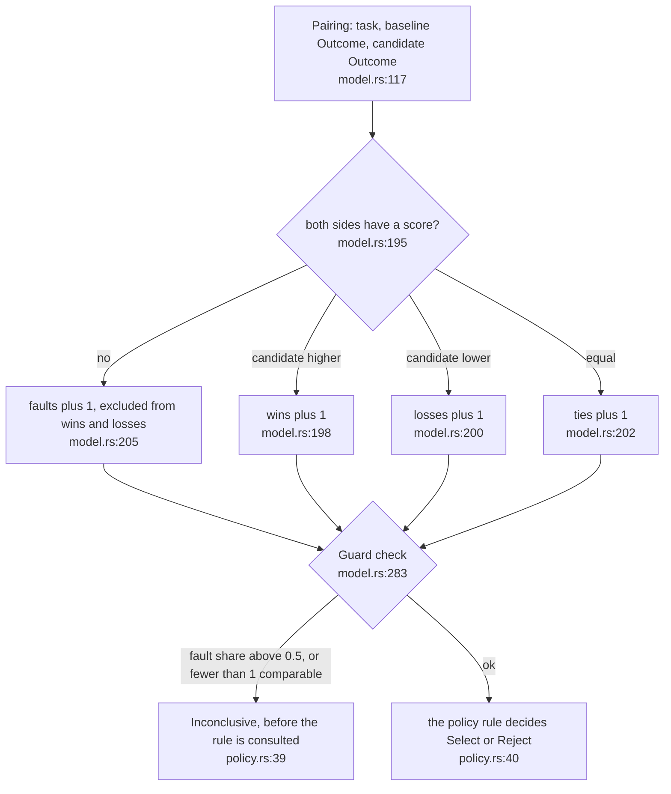
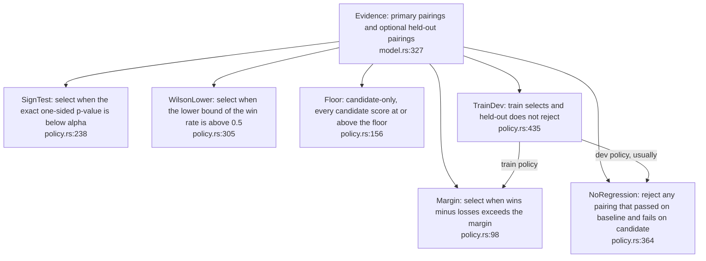
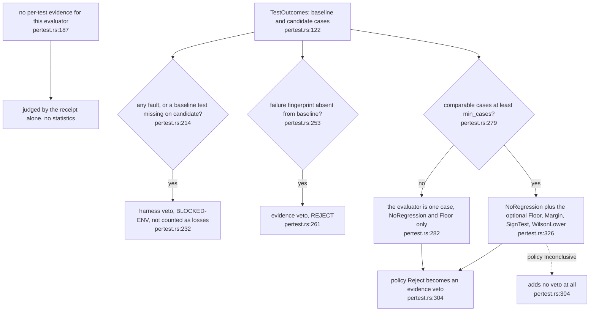

## For developers

`pairwise-gate` compares a candidate with a baseline on the same ordered list
of tasks and answers `Select`, `Reject` or `Inconclusive`
(`crates/pairwise-gate/src/lib.rs:1`). The rule that matters most is that a
fault is not a loss: an infrastructure failure on either side removes the
pairing from the tally and is reported, so trouble in the testbed is
distinguishable from evidence against the candidate
(`crates/pairwise-gate/src/lib.rs:9`). The engine's gate uses the crate
through `pertest`, which turns per-test results into pairings and maps a
policy `Reject` to an evidence veto and a fault to a harness veto.

## For the business

When a nightly change is judged on a test suite, a flaky test server must not
make a good change look bad, nor a bad change look good. The selection rules
count only comparisons where both sides produced a real result, say so when
too many did not, and never let a change that breaks a previously passing
test through on the strength of other wins.

## SEL-01.1 Tally and the inconclusive guard

**What it shows.** The shared skeleton under `Margin`, `SignTest`,
`WilsonLower` and `NoRegression`: tally, guard, then rule
(`crates/pairwise-gate/src/policy.rs:32`).
**Why it is this way.** Rankers that treat a missing score as negative
infinity would count an outage as a loss; this crate deliberately differs
(`crates/pairwise-gate/src/lib.rs:15`). A fault share exactly at the limit is
tolerated and only a larger share is inconclusive
(`crates/pairwise-gate/src/model.rs:226`).
**Invariant:** a pairing with a fault on either side is never a win or a loss
(`crates/pairwise-gate/src/model.rs:205`).

## SEL-01.2 The policies and what each selects on

**What it shows.** Six policies behind one `Policy::decide` trait method
(`crates/pairwise-gate/src/policy.rs:18`). `TrainDev` composes two of the
others and attaches both sub-decisions.
**Why it is this way.** `NoRegression` is a guard and not a proof of
improvement, so it is paired with an improvement rule through `TrainDev`
(`crates/pairwise-gate/src/policy.rs:329`). In `TrainDev` a thin or fault-heavy
held-out set makes the whole decision `Inconclusive` and never a silent pass
(`crates/pairwise-gate/src/policy.rs:394`).
**Open:** ADR-DE-004 gives 20 cases as the floor for the sign test and the
Wilson bound; the code default is the same figure
(`crates/dream-gate/src/pertest.rs:155`), and it is a field on the options.

## SEL-01.3 From per-test results to vetoes

**What it shows.** Per-test evidence is additive: it can only add vetoes
(`crates/dream-gate/src/pertest.rs:12`). Invalid options are a harness veto,
not a silently dropped policy (`crates/dream-gate/src/pertest.rs:190`).
**Why it is this way.** A statistical test on a handful of cases proves
nothing, so below `min_cases` the evaluator counts as one case
(`crates/dream-gate/src/pertest.rs:20`).
**Tension:** only `Reject` is acted on (`crates/dream-gate/src/pertest.rs:304`).
A policy that comes back `Inconclusive` on per-test evidence, for example
because too many pairings faulted at the crate level, adds no veto here. Faults
are caught separately by the harness veto at step 1, but the two layers are
not obviously equivalent.
**Debt:** evaluators with no per-test format get no statistics. Per-test
evidence exists only when the manifest declares a `test_format` for the
evaluator and a parse of both runs succeeds; otherwise the builder returns
`None`, never fabricated evidence
(`crates/dream-core/src/testfmt.rs:543`).
**Debt:** `TrainDev` and held-out dev evaluators are not wired into the nightly.
The gate's options have no held-out field and the policy builder never
constructs `TrainDev` (`crates/dream-gate/src/pertest.rs:131`,
`crates/dream-gate/src/pertest.rs:314`). ADR-DE-004 states that no consumer
supplies held-out evaluators yet
(`docs/adr/ADR-DE-004-pairwise-selection-and-fingerprints.md:55`).
