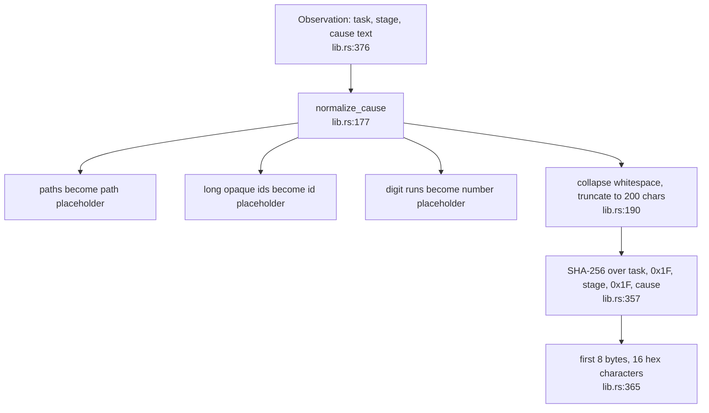
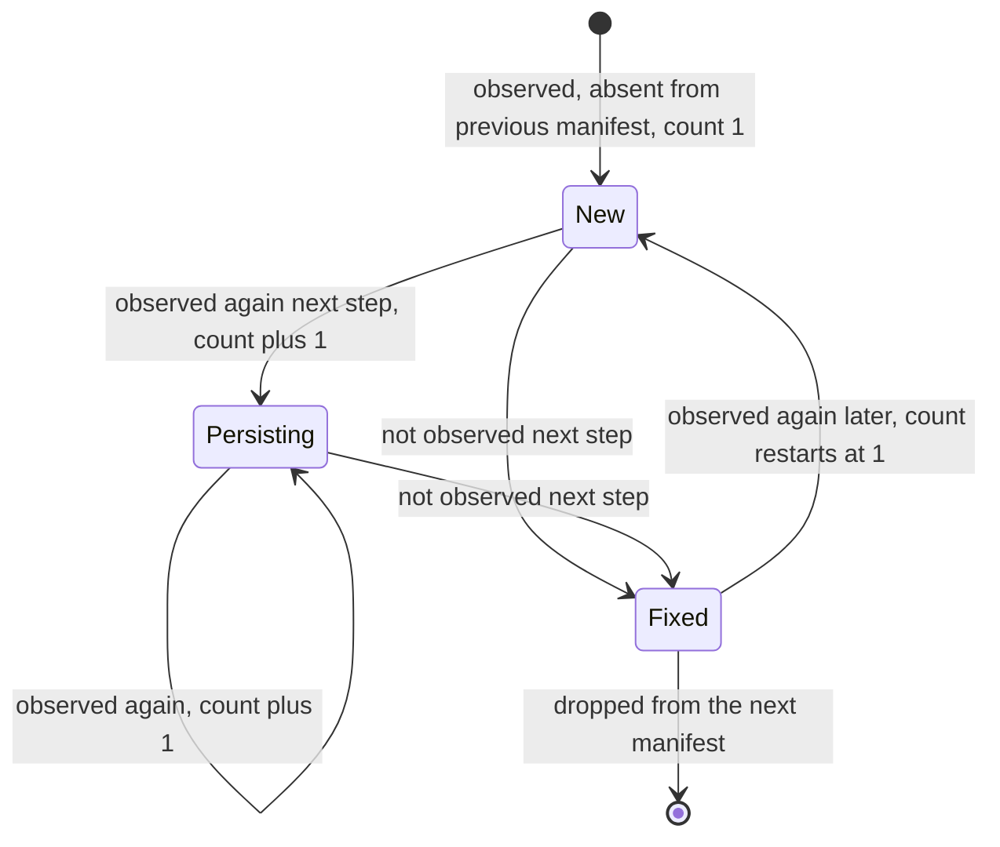
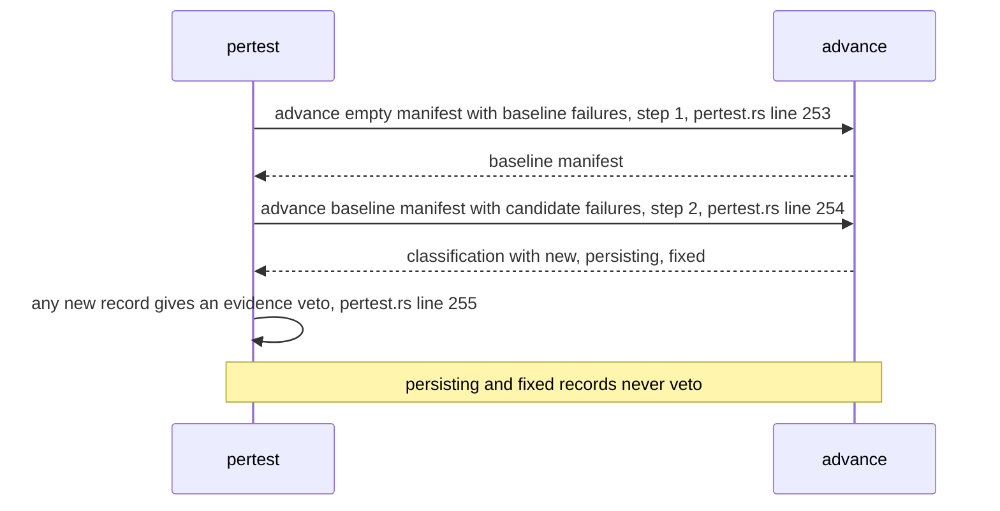
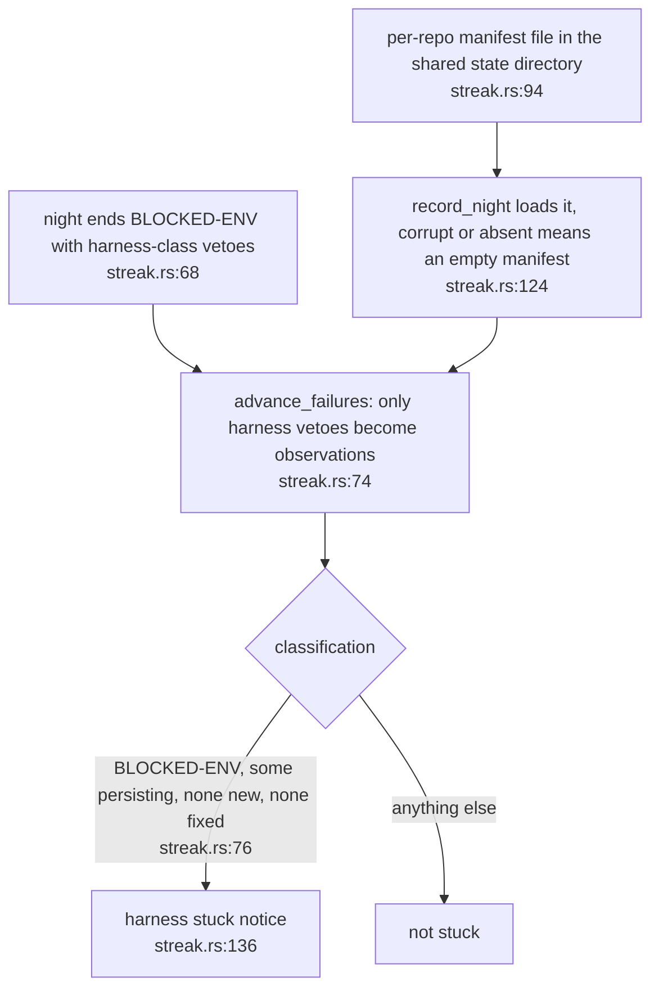

## For developers

`failure-fingerprint` gives a failure a stable identity that survives volatile
text such as temp paths, line numbers and request ids, and classifies each step's
failures against the previous manifest as `New`, `Persisting` or `Fixed`
(`crates/failure-fingerprint/src/lib.rs:1`). The identity is the first 8
bytes of SHA-256 over task, stage and the normalised cause, joined by the unit
separator (`crates/failure-fingerprint/src/lib.rs:13`). In the gate, a baseline
manifest and a candidate step are classified, and any `New` record raises an
evidence veto (`crates/dream-gate/src/pertest.rs:253`).

## For the business

The question the nightly engine needs to answer is not "is anything red" but
"did this change cause a new kind of red". A suite may already be failing on
a known problem. Giving each failure a stable name lets the engine tell the
known failure, still there, from a brand new one that the change introduced.

## SEL-02.1 From text to identity

**What it shows.** Normalisation order is paths, ids, digits, whitespace, then
truncation (`crates/failure-fingerprint/src/lib.rs:190`).
**Why it is this way.** A separator byte between fields prevents two different
splits of the same characters from colliding
(`crates/failure-fingerprint/src/lib.rs:360`). As a side effect, long opaque
identifiers such as tokens never reach a persisted cause
(`crates/failure-fingerprint/src/lib.rs:15`).
**Tension:** the identity is 64 bits (`crates/failure-fingerprint/src/lib.rs:263`).
For a single suite the chance of an accidental collision is negligible, but a
collision between a new failure and a baseline failure would classify the new
one as `Persisting` and let it past the gate's new-failure veto, with no signal.
ADR-DE-004 lists a collision seen in practice as its review trigger.

## SEL-02.2 New, persisting, fixed

**What it shows.** The lifecycle `advance` implements
(`crates/failure-fingerprint/src/lib.rs:550`). A persisting record keeps its
`first_seen_step` and increments its count
(`crates/failure-fingerprint/src/lib.rs:576`). A fixed record is a previous
record returned unchanged and absent from the next manifest
(`crates/failure-fingerprint/src/lib.rs:584`).
**Why it is this way.** Observations with the same fingerprint in one step are
de-duplicated, first wins (`crates/failure-fingerprint/src/lib.rs:562`). A
failure that disappears and returns is `New` again with its count reset
(`crates/failure-fingerprint/src/lib.rs:782`).
**Invariant:** the persisted cause is always the normalised text, never the raw
text (`crates/failure-fingerprint/src/lib.rs:410`).
**Debt:** `count` is the previous count plus one and not a strict consecutive
count; callers who need strictness check `prev.step + 1 == step`
(`crates/failure-fingerprint/src/lib.rs:539`).

## SEL-02.3 How the gate uses two steps

**What it shows.** The gate runs the lifecycle for exactly two steps inside a
single evaluator, with the stage set to the evaluator's name
(`crates/dream-gate/src/pertest.rs:247`).
**Why it is this way.** The question is only whether the candidate introduces a
failure shape the baseline did not have, so a suite that was already red is
not penalised for its known failures (`crates/dream-gate/src/pertest.rs:6`).
## SEL-02.4 The cross-night use: harness stall detection

**What it shows.** The same crate used a second way: across nights, to notice
that the same environment fault has come back, so a broken testbed is
escalated to a person and does not just look like a quiet night.
**Why it is this way.** Only harness-class vetoes are fingerprinted, so ordinary
evidence against a candidate cannot look like a stuck harness
(`crates/dream-core/src/streak.rs:236`). A corrupt manifest fails open to an
empty one (`crates/dream-core/src/streak.rs:261`).
**Open:** the evidence-gate use in SEL-02.3 restarts from an empty manifest
every night, so it needs only 64 bits to separate two trees; the cross-night use
keeps records for as long as the failure persists, which is where a long-lived
collision would matter.
